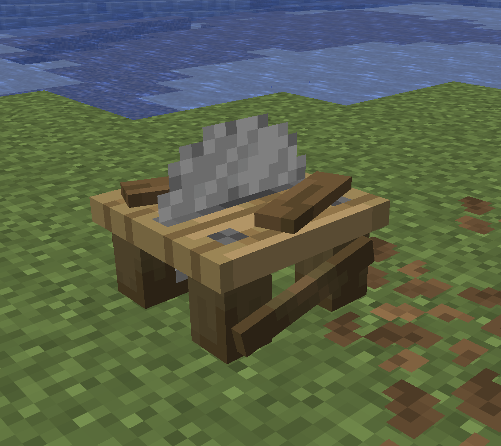
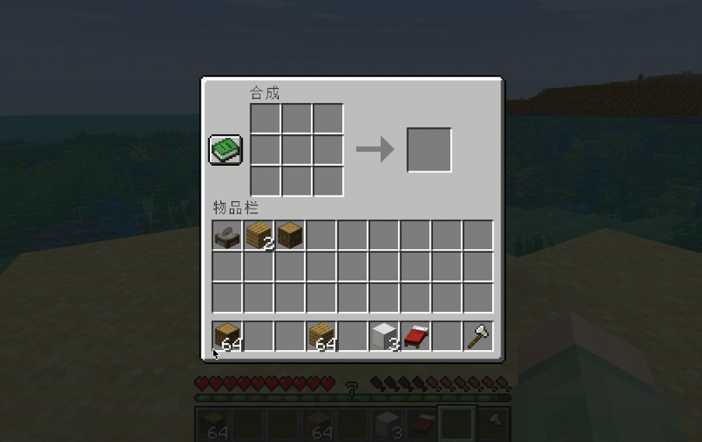
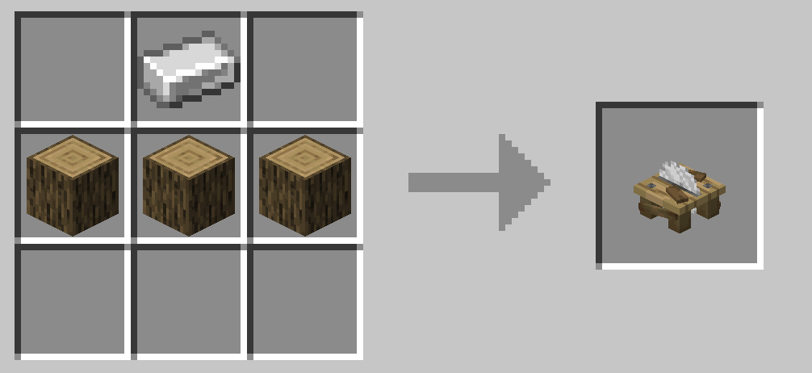
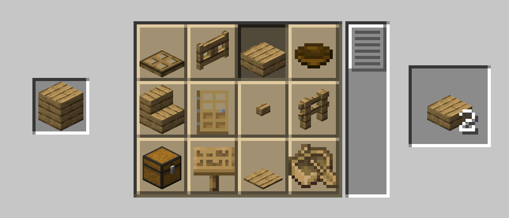

<p align="center">
  
</p>

<h1 align="center">WoodworkingSaw</h1>

<p align="center">A saw table for stripping logs and cutting planks, built on CraftEngine.</p>

<p align="center">
  
  
  
  
</p>

<p align="center">
  <b>English</b> · <a href="README-zh.md">简体中文</a>
</p>

<p align="center">
  <a href="#features">Features</a> · <a href="#quick-start">Quick Start</a> · <a href="#commands-and-permissions">Commands &amp; Permissions</a> · <a href="#configuration">Configuration</a> · <a href="#faq">FAQ</a>
</p>

WoodworkingSaw adds a saw table to your server. Cut planks into stairs, slabs, doors, fences and more, with fully customizable input/output recipes. Requires CraftEngine.

## Features

<table>
  <tr>
    <td align="center" valign="top" width="240">
      
    </td>
    <td valign="top">
      <ul>
        <li>Two recipe systems: the saw table's own transformation rules, plus vanilla stonecutter recipes injected into CraftEngine.</li>
        <li>Left-click with an empty hand opens the vanilla stonecutter GUI to cut planks into stairs, slabs, doors, fences, signs, bowls, chests, boats, and more.</li>
        <li>Right-click with an item transforms it (one by default; sneak to transform the whole stack). Rules and ratios are in <code>transformations.yml</code> and fully customizable.</li>
        <li>Automatically uploads the resource pack to CraftEngine; run <code>/ce reload all</code> to apply it.</li>
      </ul>
    </td>
  </tr>
</table>

## Demo

<p align="center">
  
</p>

## Compatibility &amp; Dependencies

| Component | Requirement |
| --- | --- |
| Server | Paper / Folia on 1.21.11 / 26.1 / 26.2 / 26.3 |
| CraftEngine | Required |
| Java | Runtime 21 / 25 |

## Quick Start

1. Drop the JAR into `plugins/` and restart.
2. Run `/sawtable give` as an admin to get a saw table.
3. Run `/ce reload all` when prompted to apply the resource pack.

## Recipes

1. Crafting the saw table (vanilla crafting table):

```text
· Stonecutter ·
Oak Planks  Oak Log  Oak Planks
Iron Block  Iron Block  Iron Block
```
(You can of course modify the saw table crafting recipe.)

<p align="center">
  
</p>

2. Left-click the saw table with an empty hand (recipes in `plugins/CraftEngine/resources/WoodworkingSaw/configuration/recipes/saw_table_cutting.yml`): planks → stairs / slabs / doors / fences / fence gates / buttons / pressure plates / trapdoors / signs / bowls / chests / boats.

<p align="center">
  
</p>

3. Right-click the saw table while holding an item: see `transformations.yml`, fully customizable. The built-in transformation chains (1:1) are:

```text
Log / Stem → Stripped Log / Stripped Stem → Fence → Fence Gate → Button
Planks → Stairs → Slab → Pressure Plate → Button
Door → Trapdoor → Button
Sapling → Stick
Tall Flower → Small Flower; Big Dripleaf → Small Dripleaf
Coral Block → Coral; Cobweb → String
Bed → Wool → Carpet → String
```

## Commands &amp; Permissions

| Command | Description | Permission |
| --- | --- | --- |
| `/sawtable give [player] [amount]` | Get a saw table | `woodworkingsaw.give` |
| `/sawtable status` | View status | `woodworkingsaw.admin` |
| `/sawtable reload` | Reload config and resources | `woodworkingsaw.admin` |

Aliases: `/woodworking`. Using the saw table requires `woodworkingsaw.use` (default: everyone).

## Configuration

- `plugins/WoodworkingSaw/config.yml` — language, sneak-to-all, sound, action bar, CraftEngine resources.
- `plugins/WoodworkingSaw/transformations.yml` — right-click transformation rules (`input`/`output`/`input-amount`/`output-amount`).
- `plugins/WoodworkingSaw/lang/` — messages (`zh_CN.yml`, `en_US.yml`).
- `plugins/WoodworkingSaw/resources/` — CraftEngine resource pack backup.

Run `/sawtable reload` after making changes.

## FAQ

| Problem | Solution |
| --- | --- |
| Cutting GUI won't open | Left-click with an empty hand; run `/ce reload all` if not loaded |
| Right-click doesn't transform | Check whether `transformations.yml` has a rule for the item |
| Can't get a saw table | Run `/ce reload all`, then `/sawtable give` |
| Can't use it | Check the `woodworkingsaw.use` permission |

## License

- Code is licensed under GPL-3.0.
- Model and texture files are for this plugin only; other plugins must not use them.
